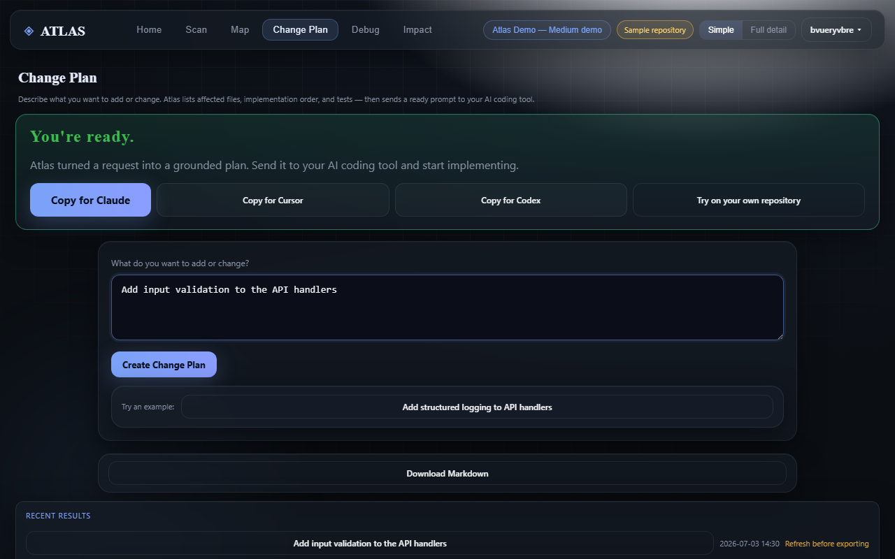

# Atlas

**A local code map for AI coding agents.** Free and open source (Apache 2.0).

Atlas scans your repository into a real dependency graph and symbol index, then serves
any MCP-compatible agent (Claude Code, Claude Desktop, Cursor, Codex) a compact,
evidence-ranked answer to the questions agents usually guess at: *which files matter for
this task*, *what breaks if I change this file*, and *where is this stack trace actually
coming from*.

Everything runs on your machine. Atlas does not call any LLM, never writes to your repo,
and never uploads your code.



> **Status:** v1.0.6-beta.2 · Windows · installer not code-signed · no signup, no account.
>
> [Download the installer](https://github.com/yoavkozokabab-blip/atlas-repo/releases/tag/v1.0.6-beta.2) · [Run from source](#run-from-source) · [MCP setup](README_MCP.md)

---

## Why

On a large or unfamiliar codebase, an agent either burns its context window opening the
wrong files, or relies on a hand-written `CLAUDE.md` / `AGENTS.md` that drifts as the code
changes. Atlas gives it a map built from the code itself: resolved imports, symbols,
subsystems and risk hotspots, saved to disk and checked against the repository before it
is reused.

## What it does

| Capability | MCP tool |
|---|---|
| Scan a repo into a dependency graph + symbol index | `atlas_scan_repo` |
| Compact, evidence-ranked context pack for a task | `atlas_build_context_pack` |
| Rank task-relevant files with reasons + confidence | `atlas_find_relevant_files` |
| Impact analysis: "what breaks if I change X" | `atlas_what_breaks` |
| Root-cause candidates from a stack trace / failing test | `atlas_root_cause` |
| Repo summary, architecture, dependency graph, health | `atlas_repo_summary`, … |
| Export context for Claude / Cursor / Codex | `atlas_export_for_*` |

18 tools in total; see [README_MCP.md](README_MCP.md). The desktop app shows the same
analysis visually (map, Impact, Debug, Change Plan) and can configure your agent's MCP
settings for you, backing up the existing config first.

Deep import analysis covers **Python and JavaScript/TypeScript**. Other languages are
indexed at file level only.

## Does it actually help?

A retrieval benchmark is included
([`scripts/bench_audit4_retrieval.py`](scripts/bench_audit4_retrieval.py)): 62 tasks
across 11 repositories (requests, flask, fastapi, pydantic, rich, typer, celery,
sqlmodel, django, langchain and Atlas itself). The "correct" file is decided without
Atlas: for symbol tasks it is the file where `class X` / `def X` is defined, found by
regex over the repo's own source.

| | Hit@1 | MRR | Recall@5 | Invented files |
|---|---|---|---|---|
| Atlas | **0.55** | **0.68** | **0.77** | 0 |
| Keyword grep / BM25 | 0.27–0.32 | | | |

Atlas also used roughly 90–97% fewer tokens than opening a naive search's top files.

What this does **not** show: it measures retrieval quality, not whether an agent finishes
tasks better. The advantage is clear against BM25 but not statistically significant
against naive grep on top-5 hits, and it is largest on big repositories. On small repos
your editor's search may be enough. More in [docs/DIFFERENTIATION.md](docs/DIFFERENTIATION.md).

## Install (Windows)

1. Download `Atlas-Setup-1.0.6-beta.2.exe` from the
   [release page](https://github.com/yoavkozokabab-blip/atlas-repo/releases/tag/v1.0.6-beta.2)
   and check its SHA-256:
   `A8129003CEF2CE1EB0D8550031608D440FA3FD0691F4C183F541B06DD97270A8`
   (PowerShell: `Get-FileHash .\Atlas-Setup-1.0.6-beta.2.exe`).
2. The installer is not code-signed, so SmartScreen will warn ("unknown publisher").
   If you'd rather not run an unsigned binary, [run from source](#run-from-source).
3. Open Atlas, choose **Continue without an account**, scan a repository, and connect
   your agent (or follow [docs/MCP_CLIENT_SETUP.md](docs/MCP_CLIENT_SETUP.md)).
4. In your agent, ask something like:
   > "Use Atlas: where is authentication handled, and what breaks if I change it?"

## Run from source

Atlas needs **Python 3.10+ and nothing else**: no third-party packages.

```bash
git clone https://github.com/yoavkozokabab-blip/atlas-repo
cd atlas-repo
py -3 run_atlas.py           # desktop UI in your browser at http://127.0.0.1:8777
py -3 run_atlas.py --mcp     # MCP server over stdio, for your agent's config
```

Only Windows is supported for the desktop app. The MCP server is plain standard-library
Python and has also been run from source on Linux.

## What leaves your machine

- **Never:** your code, file names, paths, prompts.
- **Installed app only:** a short, fixed list of anonymous product events (for example
  "scan completed" or which MCP tool was called) with a random installation ID, plus a
  version check. Opt out in Settings → *Share anonymous usage analytics*.
- **From source:** nothing.
- **Your agent** (Claude, Cursor, Codex) sends whatever context it chooses to its own
  model provider. That part is between you and them.

Full details in [PRIVACY.md](PRIVACY.md) and [docs/LOCAL_FIRST.md](docs/LOCAL_FIRST.md).

## Limitations

- Windows only for the desktop app and installer; no macOS or Linux build.
- The installer is unsigned.
- Impact analysis follows statically resolved imports. Dynamic dispatch, reflection,
  string-based imports and runtime wiring are invisible to it.
- Free-form "Ask Atlas" Q&A is disabled in this release.
- No third-party security audit.
- First scan of a very large repo can take a minute; later sessions reuse the saved scan.

## Why Atlas is free

I'm a high school student. Atlas started in May 2026 inside a personal voice-assistant
project (which is why the earliest commits look unrelated) and grew into its own
product. Over the summer I tried to turn it into a business: a website, a planned Pro
plan, messages to founders on LinkedIn, posts on Reddit. It never got a single paying
customer.

So instead of letting it sit, I'm releasing it free and open source. If it helps you,
great. If it's wrong about your codebase, please
[open an issue](https://github.com/yoavkozokabab-blip/atlas-repo/issues) with the repo
and the question; that's the most useful thing you can send me.

## Contributing and reporting problems

Issues and pull requests are welcome. Use **Report an issue** inside the app, open a
GitHub issue, or email yoavkozokabab@gmail.com. Security issues: see
[SECURITY.md](SECURITY.md).

Tests: `pip install -r requirements-dev.txt`, then `python -m pytest atlas_desktop/tests builder_core`.

## License

[Apache License 2.0](LICENSE). See also [NOTICE](NOTICE).
